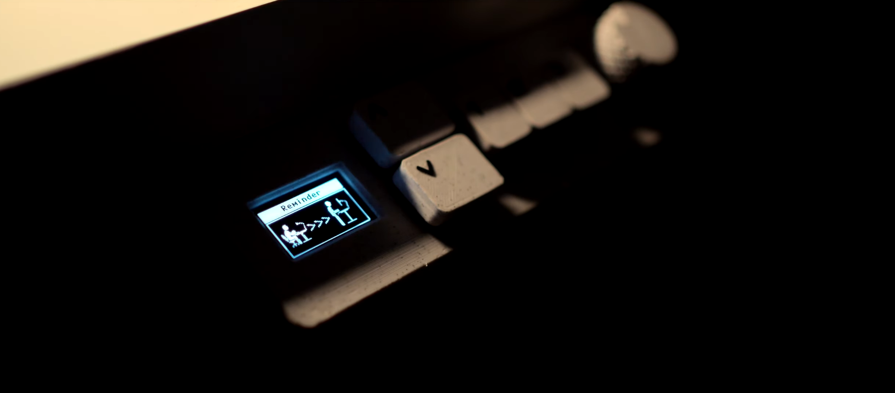
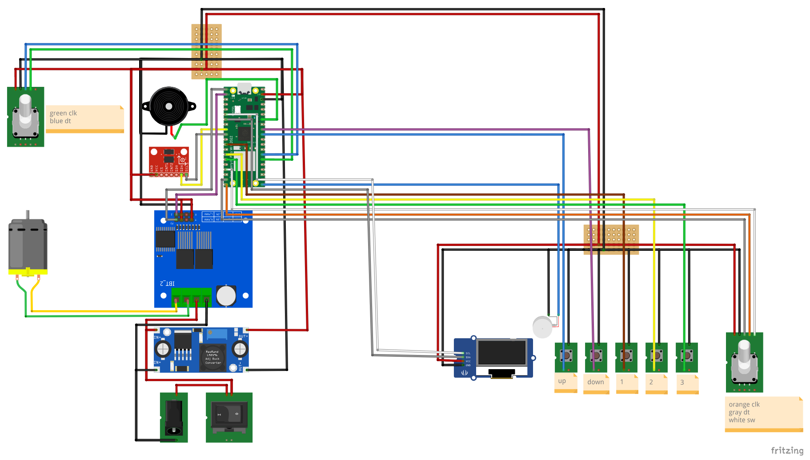

# Sit-stand desk controller on a Raspberry Pi Pico W

The firmware and hardware behind /MAIN: a broken manual IKEA Skarsta made to move on its own with a Pico W running MicroPython. H-bridge motor control, current and position sensing, an OLED and two encoders, Wi-Fi with a web interface and a REST API, preset heights, reminders, haptic feedback. Collision detection by principal component analysis is in progress.

The video: [/MAIN — Motorising a broken IKEA Skarsta with a Pi Pico W](https://www.youtube.com/watch?v=PKzvHBzcGJ4)
Everything I make, by path: [walior.it](https://walior.it/)



## 🌟 Features

### 🔧 Hardware Integration
- **Raspberry Pi Pico W** - Main controller with WiFi connectivity
- **H-Bridge Motor Control** - Precise linear actuator control with PWM
- **Multi-Sensor Safety System**:
  - Current sensing (ACS712 30A sensor)
  - 3-axis accelerometer (ADXL345)
  - Dual quadrature encoders (separate position tracking and UI navigation)
- **Professional UI**:
  - 128x64 OLED display (SH1106)
  - Dual rotary encoder system (UI navigation + position feedback)
  - Multiple tactile buttons
  - Audio/haptic feedback (buzzer + vibration motor)

### 🧠 Intelligent Features
- **Advanced Collision Detection** using Principal Component Analysis (PCA) ⚠️ *Work In Progress*
- **Multi-sensor Fusion** for enhanced safety and precision ⚠️ *Collision detection WIP*
- **Basic Safety Monitoring** with current sensing and position limits
- **WiFi Connectivity** with web-based configuration interface
- **RESTful API** for remote control and integration
- **Preset Height Management** (3 programmable positions)
- **Smart Sleep/Wake System** with posture reminders
- **Comprehensive Calibration System** for setup and maintenance
- **Dual Encoder System** - Separate position feedback and UI navigation

### 🔒 Safety & Reliability
- **Current Monitoring** to prevent motor overload
- **Position Limits** with software and hardware enforcement  
- **Graceful Error Handling** with user feedback
- **Persistent Configuration** storage with JSON files
- **Thread-safe Operations** with proper locking mechanisms
- **Future: Advanced Collision Detection** ⚠️ *Under Development*

## 📋 Table of Contents

1. [Project Status](#-project-status)
2. [Hardware Requirements](#-hardware-requirements)
3. [Pin Configuration](#-pin-configuration)
4. [Software Architecture](#-software-architecture)
5. [Installation & Setup](#-installation--setup)
6. [Configuration](#-configuration)
7. [API Reference](#-api-reference)
8. [Troubleshooting](#-troubleshooting)
9. [Contributing](#-contributing)
10. [License](#-license)

## 📊 Project Status

This project is part of the **[Micropython sit/stand smart table](https://github.com/users/waliori/projects/1)** development roadmap.

### ✅ Completed Features
- Core motor control with H-bridge integration
- WiFi connectivity and web interface
- OLED display with menu system
- Position tracking with encoders
- Preset height management
- RESTful API for remote control
- Configuration system with JSON storage

### 🚧 Work In Progress
- **Advanced Collision Detection** (PCA-based algorithm)
- **Multi-sensor Fusion** for enhanced safety
- **API collision detection endpoints**
- **Enhanced user guide and documentation**
- **Audio/sound system improvements**

### 📅 Planned Features
- Over-the-air (OTA) updates
- Enhanced web interface
- Mobile app integration
- Advanced logging and diagnostics
- Community-contributed features

### 🔗 Project Links
- **Main Project Board**: https://github.com/users/waliori/projects/1
- **Repository**: https://github.com/waliori/RP-pico-sit-stand-firmware
- **Issues & Features**: https://github.com/waliori/RP-pico-sit-stand-firmware/issues

## 🔌 Hardware Requirements

### Core Components

| Component | Model/Specification | Quantity | Notes |
|-----------|-------------------|----------|-------|
| **Microcontroller** | Raspberry Pi Pico W | 1 | WiFi-enabled version required |
| **Motor Driver** | H-Bridge (capable of handling desk motor) | 1 | PWM-controlled, sufficient current rating |
| **Current Sensor** | ACS712-30A | 1 | 30A version, 66mV/A sensitivity |
| **Accelerometer** | ADXL345 | 1 | 3-axis, I2C interface |
| **Display** | SH1106 OLED 128x64 | 1 | I2C interface |
| **Position Encoder** | Quadrature Encoder (left side) | 1 | Motor position feedback only |
| **UI Encoder** | Rotary Encoder with Button (right side) | 1 | UI navigation only |
| **Buttons** | Tactile Push Buttons | 5 | Up, Down, Preset 1-3 |
| **Audio Feedback** | PWM Buzzer | 1 | Piezo buzzer, PWM-driven |
| **Haptic Feedback** | Vibration Motor | 1 | Small DC motor |

### Supporting Components

- **12V Power Supply**: For motor power
- **3.3V Regulator**: Powers all electronics from 12V  
- **Custom PCB**: For component mounting and connections
- **Connection Wires**: For linking components
- **3D Printed Parts**: Custom enclosures and mounting solutions

**Notes**: 
- All electronics run on 3.3V (except motor which uses 12V)
- Uses Pico W's internal pull-up resistors - no external resistors needed
- **🎨 3D Models**: Full CAD files available at [OnShape CAD Document](https://cad.onshape.com/documents/f9483c31494feda60f507100/w/67832ca84d886d2bfa4006b1/e/62aed646cd76d0a16e7ccfc5?renderMode=0&uiState=68916ac8ffbe3d6103e400d4)
- **📐 Wiring Diagrams**: 
  - [Wiring Diagram (PDF)](docs/schematics/wiring-diagram.pdf) - Complete breadboard-style wiring schematic
  - [Wiring Diagram (Fritzing)](docs/schematics/wiring-diagram.fzz) - Editable Fritzing source file
  

## 📍 Pin Configuration

### Raspberry Pi Pico W Pinout

```
╭─────────────────────────────────────╮
│              GPIO ASSIGNMENTS        │
├─────────────────────────────────────┤
│ Motor Control:                      │
│   GPIO 0  - H-Bridge R_PWM (Right)  │
│   GPIO 1  - H-Bridge L_PWM (Left)   │
│                                     │
│ Display & Communication (I2C0):     │
│   GPIO 4  - OLED SDA                │
│   GPIO 5  - OLED SCL                │
│                                     │
│ Sensors (I2C1):                     │
│   GPIO 6  - Accelerometer SDA       │
│   GPIO 7  - Accelerometer SCL       │
│                                     │
│ User Interface:                     │
│   GPIO 9  - Preset Button 1         │
│   GPIO 10 - Preset Button 2         │
│   GPIO 11 - Preset Button 3         │
│   GPIO 13 - UI Encoder Button       │
│   GPIO 14 - UI Encoder DT           │
│   GPIO 15 - UI Encoder CLK          │
│                                     │
│ Motor Position Encoder (Left):      │
│   GPIO 20 - Position Encoder CLK    │
│   GPIO 21 - Position Encoder DT     │
│                                     │
│ Audio/Haptic Feedback:              │
│   GPIO 16 - Vibration Motor         │
│   GPIO 22 - PWM Buzzer              │
│                                     │
│ Control Buttons:                    │
│   GPIO 26 - Down Button             │
│   GPIO 27 - Up Button               │
│                                     │
│ Analog Input:                       │
│   GPIO 28 - Current Sensor (ADC)    │
╰─────────────────────────────────────╯
```

### Connection Diagrams

#### Power Connections
```
Pico W 3.3V ──┬── All Electronics:
                ├── OLED Display
                ├── Accelerometer
                ├── Current Sensor
                ├── Rotary Encoders
                └── Buttons & Buzzer

12V Supply ─────── Motor (via H-Bridge)

Common GND ─────── All components
```

#### I2C Bus Configuration
```
I2C0 (Display):          I2C1 (Sensors):
GPIO 4 (SDA) ──── OLED   GPIO 6 (SDA) ──── ADXL345
GPIO 5 (SCL) ──── OLED   GPIO 7 (SCL) ──── ADXL345
```

#### Dual Encoder Configuration
```
Left Encoder (Position):     Right Encoder (UI):
GPIO 20 (CLK) ──── Motor     GPIO 15 (CLK) ──── Menu Navigation
GPIO 21 (DT)  ──── Position  GPIO 14 (DT)  ──── Menu Navigation
                             GPIO 13 (SW)  ──── Menu Button
```

## 🏗️ Software Architecture

### System Overview

```
┌─────────────────────────────────────────────────────────────┐
│                     Application Layer                       │
├─────────────────────────────────────────────────────────────┤
│  main.py           │  Setup & Main Loop                     │
│  menu.py           │  User Interface Management             │
│  wifi.py           │  Network & Web Interface              │
├─────────────────────────────────────────────────────────────┤
│                    Control Layer                            │
├─────────────────────────────────────────────────────────────┤
│  motor.py          │  Motor Control & Basic Safety         │
│  calibration.py    │  System Calibration & Configuration   │
│  presets.py        │  Height Preset Management             │
│  collision.py      │  🚧 Collision Detection (WIP)         │
├─────────────────────────────────────────────────────────────┤
│                   Hardware Layer                            │
├─────────────────────────────────────────────────────────────┤
│  display.py        │  OLED Display Management               │
│  accelerometer.py  │  Motion Sensor Interface              │
│  acs712.py         │  Current Sensor Interface             │
│  buzz_vib.py       │  Audio/Haptic Feedback                │
├─────────────────────────────────────────────────────────────┤
│                   Support Layer                             │
├─────────────────────────────────────────────────────────────┤
│  songs.py          │  Audio Notification Patterns          │
│  rtttl.py          │  Music Format Parser                  │
│  sh1106.py         │  OLED Display Driver                  │
│  writer.py         │  Font Rendering System                │
└─────────────────────────────────────────────────────────────┘
```

### Core Modules

#### 1. Motor Control System (`motor.py`)
- **PWM Motor Control**: Precision speed and direction control
- **Encoder Integration**: Real-time position feedback
- **Basic Safety Monitoring**: Current monitoring and position limits
- **API Support**: Asynchronous motor control for web interface
- **Future: PCA-based Analysis** ⚠️ *Under Development*

#### 2. Collision Detection (`collision.py`) 🚧 *Work In Progress*
- **⚠️ Development Status**: Advanced collision detection is currently being implemented
- **Planned Features**: Principal Component Analysis for statistical anomaly detection
- **Future Capabilities**: Multi-sensor fusion (accelerometer + current + RPM)
- **Target Features**: Adaptive thresholds and direction-specific detection
- **Current Status**: Basic framework in place, algorithm implementation ongoing

#### 3. Calibration System (`calibration.py`)
- **Multi-phase Setup**: Height limits, sensor baselines, safety thresholds
- **Persistent Storage**: JSON-based configuration management
- **Real-time Updates**: Dynamic recalibration capabilities
- **Height Mapping**: Encoder-to-real-world height conversion
- **Safety Validation**: Limit verification and enforcement

#### 4. WiFi & Web Interface (`wifi.py`)
- **Auto-connection**: Intelligent network discovery and connection
- **Access Point Mode**: Fallback configuration interface
- **Web Portal**: HTML-based setup and control interface
- **RESTful API**: Complete remote control capabilities
- **Security**: Password-protected networks and saved credentials

#### 5. Display System (`display.py`)
- **Multi-font Support**: 20pt and 30pt font rendering
- **Icon System**: WiFi, lock, sound, and status indicators
- **Menu Framework**: Hierarchical navigation system
- **Animation Support**: Progress bars and visual feedback
- **Power Management**: Sleep and wake functionality

### Data Flow Architecture

```
┌─────────────────────────────────────────────────────────────┐
│                    DUAL ENCODER SYSTEM                     │
├─────────────────────────────────────────────────────────────┤
│  Position Encoder (Left) ──► Motor Control ──► Basic Safety │
│     GPIO 20/21                     │              │         │
│                                    ▼              ▼         │
│  UI Encoder (Right) ──► Display ──► Height Display Safety   │
│     GPIO 13/14/15       System       Updates     Actions   │
│                           │                                 │
│  Physical Buttons ────────┤                                 │
│  (Up/Down/Presets)        │                                 │
│                           ▼                                 │
│                      Menu Navigation                        │
└─────────────────────────────────────────────────────────────┘
                           │
                           ▼
┌─────────────────────────────────────────────────────────────┐
│                    SENSOR FUSION                           │
├─────────────────────────────────────────────────────────────┤
│  Accelerometer (GPIO 6/7) ──┐                              │
│                              ├─► Safety Monitoring         │
│  Current Sensor (GPIO 28) ───┘         │                   │
│                                         ▼                   │
│                              🚧 Future: Advanced Collision  │
│                                 Detection (PCA-based)       │
└─────────────────────────────────────────────────────────────┘
                           │
                           ▼
┌─────────────────────────────────────────────────────────────┐
│                  CONTROL INTERFACES                        │
├─────────────────────────────────────────────────────────────┤
│  Web API (WiFi) ──────────┐                                │
│                           ├─► Motor Commands               │
│  Physical Controls ───────┘     │                          │
│  (Buttons/Encoders)              ▼                          │
│                            H-Bridge Control                │
│                            (GPIO 0/1 PWM)                  │
└─────────────────────────────────────────────────────────────┘
                           │
                           ▼
┌─────────────────────────────────────────────────────────────┐
│                 PERSISTENT STORAGE                         │
├─────────────────────────────────────────────────────────────┤
│  settings.json ◄─── Calibration System                     │
│  presets.json  ◄─── Preset Management                      │
│  state.json    ◄─── Current Position                       │
│  saved_wifi.json ◄─ Network Credentials                    │
└─────────────────────────────────────────────────────────────┘
```

## 🚀 Installation & Setup

### Prerequisites

1. **MicroPython Firmware**: Install latest MicroPython on Raspberry Pi Pico W
2. **Development Environment**: 
   - Thonny IDE (recommended for beginners)
   - VS Code with MicroPython extension
   - Command line tools (ampy, rshell, mpremote)

### Step 1: Hardware Assembly

1. **Connect Components** according to the pin configuration above
2. **Verify Power Supply** ratings and connections
3. **Test Individual Components** before full assembly
4. **Secure Connections** and check for shorts

### Step 2: Firmware Installation

```bash
# Clone the repository
git clone https://github.com/waliori/RP-pico-sit-stand-firmware.git
cd RP-pico-sit-stand-firmware

# Upload files to Pico W (using mpremote)
mpremote fs cp *.py :
mpremote fs cp lib/* :lib/

# Alternative: Using Thonny IDE
# 1. Open Thonny
# 2. Configure for Raspberry Pi Pico
# 3. Upload all .py files to the device
```

### Step 3: Initial Configuration

1. **Power On**: The system will start in calibration mode
2. **Height Calibration**:
   - Move desk to highest position → Press and hold rotary encoder
   - Set maximum height value using rotary encoder
   - Move desk to lowest position → Press and hold rotary encoder  
   - Set minimum height value using rotary encoder
3. **WiFi Setup**: 
   - Connect to "PicoW" access point (password: waliori123)
   - Navigate to 192.168.4.1
   - Configure WiFi credentials

### Step 4: Safety Calibration

1. **Collision Calibration**:
   - Access "Collision Reset" from main menu
   - Move desk through full range while system learns normal operation
   - Confirm calibration completion

2. **Verification**:
   - Test all movement directions
   - Verify collision detection with safe obstacles
   - Confirm preset functionality

## ⚙️ Configuration

### System Settings (`settings.json`)

```json
{
  "min_encoder": 0,
  "max_encoder": 5000,
  "min_real": 72.0,
  "max_real": 120.0,
  "sleep_time": 30,
  "reminder_time": 5400,
  "rpm_up": 120.0,
  "rpm_down": 115.0,
  "current_up": 2.5,
  "current_down": 2.2,
  "accel_up": [100, 150, 980],
  "accel_down": [95, 145, 985],
  "principal_components_up": [[...], [...]],
  "principal_components_down": [[...], [...]],
  "projected_mean_up": [0.5, 0.3],
  "projected_mean_down": [0.4, 0.2]
}
```

### WiFi Configuration (`saved_wifi.json`)

```json
{
  "HomeNetwork": "password123",
  "OfficeWiFi": "securepass456"
}
```

### Preset Heights (`presets.json`)

```json
{
  "1": 2500,
  "2": 3750,
  "3": 4200
}
```

### Menu System Navigation

```
Main Menu
├── WiFi
│   ├── Connect to saved networks
│   ├── Scan for new networks
│   ├── Access Point mode
│   └── API toggle
├── Configuration
│   ├── Sleep timer settings
│   ├── Min/Max height adjustment
│   ├── Posture reminder timer
│   ├── Vibration on/off
│   └── Sound settings
├── Lock/Unlock
├── Show Presets
├── Show Min/Max
├── Collision Reset
└── Factory Reset
```

## 🌐 API Reference

### Base URL
```
http://<pico-ip-address>/
```

### Endpoints

#### Status & Information

**Get Current Height**
```http
GET /get_height
```
Response:
```json
{"height": "95.5"}
```

**Get Min/Max Heights**
```http
GET /get_minmax
```
Response:
```json
{"min": 72.0, "max": 120.0}
```

**Get Presets**
```http
GET /get_presets
```
Response:
```json
["1: 95.5", "2: 110.0", "3: 115.2"]
```

**Check Lock Status**
```http
GET /islocked
```
Response:
```json
{"locked": false}
```

#### Control Commands

**Move Up**
```http
GET /forward
```

**Move Down**
```http
GET /backward
```

**Stop Movement**
```http
GET /stop
```

**Go to Specific Height**
```http
GET /go?height=100.5
```

**Go to Preset**
```http
GET /go_preset?preset=1
```

#### Security & Settings

**Lock Desk**
```http
GET /lock
```

**Unlock Desk**
```http
GET /unlock
```

**Set Minimum Height**
```http
GET /set_min?min=70.0
```

**Set Maximum Height**
```http
GET /set_max?max=125.0
```

### Response Format

All API responses include CORS headers and follow this structure:

**Success Response:**
```json
{
  "status": "ok",
  "data": "..."
}
```

**Error Response:**
```json
{
  "status": "nok",
  "error": "Description of error"
}
```

## 🔧 Advanced Features

### Current Safety Features

- **Position Limits**: Software-enforced minimum and maximum heights
- **Current Monitoring**: Motor current sensing for overload protection
- **Manual Controls**: Physical buttons for direct desk control
- **Emergency Stop**: Immediate motor shutdown capability

### 🚧 Future: Advanced Collision Detection (Work In Progress)

The system is being developed to include Principal Component Analysis (PCA) for sophisticated obstacle detection:

**Planned Implementation**:
1. **Multi-sensor Data Collection**: 3-axis accelerometer, motor current, RPM
2. **Statistical Analysis**: Real-time normalization and PCA projection
3. **Adaptive Thresholds**: Dynamic sensitivity adjustment
4. **Direction-specific Calibration**: Separate learning for up/down movement

**Development Status**: Framework implemented, algorithm integration in progress

### Power Management

- **Sleep Mode**: OLED turns off after configurable timeout
- **Wake on Input**: Any button press or encoder movement
- **Posture Reminders**: Configurable alerts for movement
- **Low Power WiFi**: Optimized power management for wireless

### Security Features

- **Physical Lock**: Disable all movement commands
- **API Authentication**: Future expansion capability
- **Safe Mode**: Reduced sensitivity for maintenance
- **Position Limits**: Software-enforced boundaries

## 🐛 Troubleshooting

### Common Issues

**Problem**: Desk doesn't move when buttons are pressed
- **Check**: Motor driver connections and power supply
- **Check**: H-bridge enable signals and PWM outputs  
- **Check**: Encoder connections for position feedback
- **Solution**: Verify all connections match pin configuration

**Problem**: Basic safety monitoring issues
- **Check**: Current sensor calibration and connections
- **Check**: Position encoder feedback
- **Solution**: Verify sensor connections and recalibrate system
- **Note**: Advanced collision detection is under development

**Problem**: WiFi connection fails
- **Check**: Network credentials in saved_wifi.json
- **Check**: WiFi signal strength and network availability
- **Solution**: Use access point mode for reconfiguration

**Problem**: Display shows incorrect height
- **Check**: Encoder connections and mechanical coupling
- **Solution**: Run full height calibration sequence

**Problem**: System freezes or becomes unresponsive
- **Check**: Power supply stability and current capacity
- **Check**: I2C bus conflicts or wiring issues
- **Solution**: Power cycle and check console output

### Debug Mode

Enable debug output by modifying `main.py`:

```python
DEBUG = True  # Add this line at the top

# Add debug prints throughout code
if DEBUG:
    print(f"Debug: Current height = {height}")
```

### Log Analysis

Monitor system behavior through UART:

```bash
# Using screen (Linux/Mac)
screen /dev/ttyACM0 115200

# Using PuTTY (Windows)
# Connect to COM port at 115200 baud
```

### Factory Reset

1. **Software Reset**: Access "Factory Reset" from main menu
2. **Hardware Reset**: Hold BOOTSEL button while powering on
3. **Full Reinstall**: Re-upload all firmware files

## 🤝 Contributing

We welcome contributions to improve this project!

### Development Setup

1. **Fork the Repository**
2. **Create Feature Branch**: `git checkout -b feature/amazing-feature`
3. **Install Development Tools**:
   ```bash
   pip install micropython-stubs
   pip install black  # Code formatting
   pip install pylint # Code analysis
   ```

### Code Standards

- **Python Style**: Follow PEP 8 guidelines
- **Documentation**: Include docstrings for all functions
- **Comments**: Explain complex logic and hardware interactions
- **Testing**: Test on actual hardware before submitting

### Contribution Areas

- **Hardware Support**: Additional sensor integrations
- **Safety Features**: Enhanced collision detection algorithms
- **UI Improvements**: Better display layouts and animations
- **API Extensions**: Additional control endpoints
- **Documentation**: Tutorials, guides, and examples

### Pull Request Process

1. **Update Documentation** for any new features
2. **Test Thoroughly** on hardware
3. **Update Version Numbers** if applicable
4. **Submit Pull Request** with clear description

## 📜 License

This project is licensed under the MIT License - see the [LICENSE](LICENSE) file for details.

```
MIT License

Copyright (c) 2024 waliori

Permission is hereby granted, free of charge, to any person obtaining a copy
of this software and associated documentation files (the "Software"), to deal
in the Software without restriction, including without limitation the rights
to use, copy, modify, merge, publish, distribute, sublicense, and/or sell
copies of the Software, and to permit persons to whom the Software is
furnished to do so, subject to the following conditions:

The above copyright notice and this permission notice shall be included in all
copies or substantial portions of the Software.

THE SOFTWARE IS PROVIDED "AS IS", WITHOUT WARRANTY OF ANY KIND, EXPRESS OR
IMPLIED, INCLUDING BUT NOT LIMITED TO THE WARRANTIES OF MERCHANTABILITY,
FITNESS FOR A PARTICULAR PURPOSE AND NONINFRINGEMENT. IN NO EVENT SHALL THE
AUTHORS OR COPYRIGHT HOLDERS BE LIABLE FOR ANY CLAIM, DAMAGES OR OTHER
LIABILITY, WHETHER IN AN ACTION OF CONTRACT, TORT OR OTHERWISE, ARISING FROM,
OUT OF OR IN CONNECTION WITH THE SOFTWARE OR THE USE OR OTHER DEALINGS IN THE
SOFTWARE.
```

## 🙏 Acknowledgments

- **Raspberry Pi Foundation** for the excellent Pico W platform
- **MicroPython Community** for the robust embedded Python implementation
- **Open Source Libraries**: SH1106, ADXL345, and other hardware drivers
- **Contributors**: All developers who have helped improve this project

## 📞 Support

- **Issues**: [GitHub Issues](https://github.com/waliori/RP-pico-sit-stand-firmware/issues)
- **Discussions**: [GitHub Discussions](https://github.com/waliori/RP-pico-sit-stand-firmware/discussions)
- **Build Video**: [🎬 YouTube Documentary](https://www.youtube.com/watch?v=PKzvHBzcGJ4) - Complete build process
- **Email**: Contact the maintainer through GitHub profile

---

**⚠️ Safety Notice**: This controller manages potentially dangerous mechanical equipment. Always verify all safety features are working correctly before use. Never bypass safety mechanisms. Use appropriate electrical protection and follow local electrical codes.

**🔌 Electrical Warning**: This project involves mains-powered equipment. Ensure proper electrical isolation and safety measures. When in doubt, consult a qualified electrician.

---

Made with ❤️ by [waliori](https://walior.it) | [Project Website](https://github.com/waliori/RP-pico-sit-stand-firmware)